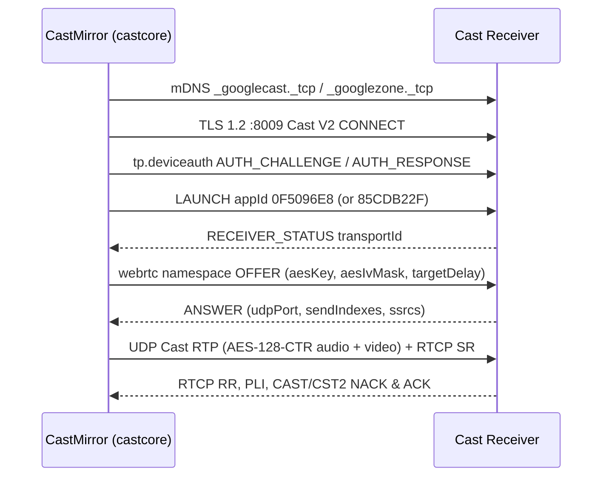
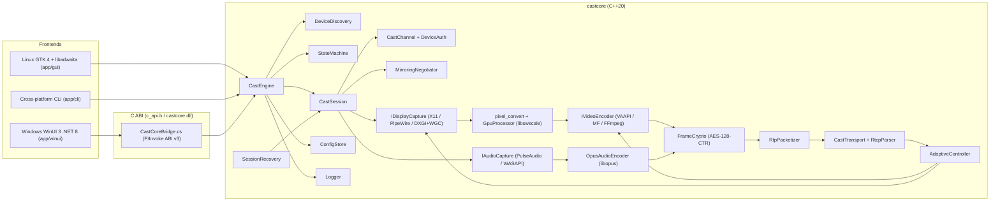

# CastMirror: Native Chromecast Display Mirroring

**Date:** 2026-11-18  
**Version:** 1.0.4  
**Status:** Implemented — Linux GTK 4 + libadwaita desktop app (`castmirror-gui`), Windows WinUI 3 desktop app (`CastMirror.exe` over `castcore.dll`), and cross-platform CLI (`castmirror`) sharing `castcore`.

---

## 1. Product requirements and UX contract

**One-click loop:** open app → nearby TVs appear → select one (or use last TV) → **Cast display** / **Start casting** → desktop (or single window) + optional system/per-app audio on the TV within seconds → **Stop** ends capture immediately.

**Non-goals for v1:** cloud relay, multi-room video groups, sending files/URLs/tabs, remote mouse/keyboard to the TV, end-to-end HDR pipeline (Windows HDR scRGB frames are tone-mapped to SDR), DRM content (protected video renders black by OS design).

**Success bar (primary path, LAN, modern GPU):**

- Time from Cast click to first TV frame: **≤ 8 s** typical, **≤ 12 s** p95 (`launch_timeout_s` default 8 s + `answer_timeout_s` default 5 s)
- Glass-to-glass latency: **~200 ms** typical on a clean 5 GHz LAN at the default `targetDelay` 200 ms (Chrome-class)
- 1080p30 on all Cast video devices; 1080p60 on Chromecast 3rd gen and newer; 1440p/4K when source, decoder, encoder, and network all allow it
- Capture **must not** run except while an active Cast session is streaming (enforced in Release and Debug via `CheckCaptureInvariant` in `core/include/castcore/types.h`)
- Stop must halt capture/encode/sockets within **500 ms** (`StopBudgetTimer` / `MeasureStopBudgetMs` warns above 400 ms)

**Honest latency ceiling:** this product feels like Chrome’s “Cast screen”, not Sunshine/Moonlight (~20–50 ms). Latency is dominated by the receiver’s **target playout delay**. CastMirror requests **200 ms** by default (`Game` starts at 150 ms, `Cinema` at 400 ms, Settings slider allows 100–400 ms) and `AdaptiveController` keeps runtime delay in a 150–400 ms band, stepping 150→200→300→400 ms when EWMA jitter exceeds 30 ms, loss exceeds 3%, NACK pressure triggers, or PLI arrives, and back down after 15 consecutive clean intervals (0 loss, 0 NACKs, no PLI, EWMA RTT < 25 ms, EWMA jitter < 8 ms). Chrome’s own default is **400 ms**.

**User-visible quality presets:** `Auto` / `High` / `Balanced` / `Smooth` / `Game` / `Cinema`, plus a per-preset video bitrate slider (`1–25 Mbps`).

**Shipping surface (1.0.4):**
- **Linux (`app/gui`, `app/cli`):** GTK 4 (`>= 4.12`) + libadwaita (`>= 1.5`) GUI (`castmirror-gui`) and CLI (`castmirror`) linked statically against `castcore`. Video capture uses **X11** (XRandR monitor crop + MIT-SHM / XComposite + XDamage + XFixes window capture) or **Wayland** (`xdg-desktop-portal` ScreenCast + PipeWire `pw_stream` with DMA-BUF NV12 zero-copy). Audio uses **PulseAudio/PipeWire** default sink monitor (`libpulse`). Video encoding uses **VAAPI** (`h264_vaapi`) with software fallback to **`libx264`** (`superfast`, `zerolatency`, High profile, 0 B-frames) or FFmpeg's H.264 encoder (e.g. `libopenh264` on Fedora `ffmpeg-free`), plus **VP8** (`libvpx`) via CLI `--codec vp8` / config.
- **Windows (`app/winui`, `app/cli`):** .NET 8 / Windows App SDK 1.6 WinUI 3 client (`CastMirror.exe`) calling `castcore.dll` via P/Invoke (`core/include/castcore/c_api.h`, ABI v3) alongside the native `castmirror.exe` CLI. Video capture uses **DXGI Desktop Duplication** (with `FramePacer` cadence and `pixel_convert.cc` HDR scRGB-to-SDR tone mapping) and **`Windows.Graphics.Capture`** (`WgcWindowSource`) for occluded-free single-window capture (with desktop-crop fallback). Audio uses **WASAPI** loopback including per-process audio isolation (`audio_sessions.cc` + `VAD\Process_Loopback` on Windows 10 2004+). Video encoding uses **Media Foundation** hardware H.264 MFTs (`MediaFoundationVideoEncoder`) with automatic fallback to `FFmpegVideoEncoder` (`libx264`).

---

## 2. How Chromecast display mirroring works

### Public Google APIs (not sufficient)

Official Cast Sender SDKs exist for web, Android, and iOS only. They can discover devices, launch a registered Web Receiver, load a media URL (HLS/DASH/progressive HTTP), and send custom JSON messages, but they **cannot** capture a desktop or speak Chrome’s real-time mirroring path. HTTP media “fling” buffering typically yields 1–8+ seconds of latency.

### Cast Streaming wire protocol (Chromium-compatible)

CastMirror implements the same control and media protocol used by Chrome’s “Cast screen” and Google’s Open Screen specification natively in C++20 inside `castcore` (it does **not** link Open Screen `libcast`):

1. **Discovery:** mDNS/DNS-SD `_googlecast._tcp.local` and `_googlezone._tcp.local` (`id`, `fn`, `md`, `ca`, `st`, `ve` TXT records) plus optional `/24` subnet TCP:8009 probe + HTTP `:8008/setup/eureka_info`.
2. **Control:** TLS 1.2 to port **8009** (Cast V2). 4-byte big-endian length-prefixed protobuf `CastMessage` across `.tp.connection`, `.tp.heartbeat`, `.tp.deviceauth`, `.receiver`, and `.webrtc`.
3. **Device authentication:** `urn:x-cast:com.google.cast.tp.deviceauth` nonce challenge/response verified against embedded **Google Cast Root CA** and **Eureka Root CA** certificates (`core/src/device_auth.cc`, enabled by default, bypassable with `--no-verify`).
4. **Launch receiver firmware app:** `0F5096E8` (audio+video mirroring) or `85CDB22F` (audio-only), pinned in `core/include/castcore/cast_app_ids.h` and checked weekly against Chromium `cast_media_source.cc`.
5. **Session negotiation:** JSON `OFFER` / `ANSWER` / `GET_STATUS` / `STATUS` on `urn:x-cast:com.google.cast.webrtc` (not ICE/DTLS WebRTC), exchanging fresh per-stream AES-128-CTR keys (`aesKey`, `aesIvMask`), codec (`h264` or `vp8` + `opus`), `targetDelay`, SSRCs, and receiver `udpPort`.
6. **Media:** Cast Streaming over **UDP** (`rtpProfile: "cast"`), 12-byte RTP + 7-byte Cast header (19-byte base header) + optional 4-byte adaptive playout delay extension, AES-128-CTR per-frame payload encryption, token-bucket pacing, compound RTCP (`RR`, `PLI`, `CAST`/`CST2` NACKs & ACKs), and `AdaptiveController` rate/resolution/delay adaptation.

---

## 3. Architecture choices

| Approach | Latency | Compatibility | Complexity | License / risk | Verdict |
|---|---|---|---|---|---|
| **A. Native Cast Streaming (`castcore`) to firmware mirroring app** | 150–400 ms | All Cast video devices Chrome mirrors to | High, self-contained C++20 in `castcore` | Apache-2.0 source (GPL binary when linked with `libx264`); app-ID drift checked by CI | **Implemented primary** |
| **B. Embed / automate Chrome** | Chrome-class | Excellent | Poor UX / heavy dependency | ToS / UX | Rejected |
| **C. Extract Chromium Mirroring Service** | Chrome-class | Excellent | Extreme (Mojo, GPU process) | BSD | Rejected |
| **D. Local HTTP + Default/Styled Media Receiver** | 2–8 s | Excellent | Low | Public API | Rejected |
| **E. Custom CAF receiver + LL-CMAF/fMP4 HTTP** | ~1–3 s | Needs registered receiver + HTTPS origin | Medium | Static CAF prototype in `receiver-fallback/` | **Unshipped research stub** |

`receiver-fallback/` contains only a minimal CAF receiver HTML/JS/CSS stub (`index.html`, `receiver.js`, `receiver.css`) retained from early fallback research; `castcore` has no HTTP segment server.

---

## 4. System architecture and module layout

`castcore` (`core/`) is a C++20 library (static on Linux, plus `castcore.dll` shared library on Windows) that owns capture, color conversion, encode, Cast V2 control, Cast RTP/RTCP transport, adaptation, recovery, config, and logging. Front-ends own only presentation and user intent.

### Media paths

- **Video path (Linux X11 / Wayland CPU fallback / Windows):**
  1. Capture delivers BGRA frames (`X11DisplayCapture`, `PipeWirePortalCapture` `MemPtr`/`MemFd`/`DmaBuf` mmap, `DisplayCaptureWgc` via DXGI or `WgcWindowSource`). On Windows, `ConvertToBgra8` (`pixel_convert.cc`) converts `BGRA8`, `RGBA8`, `RGB10A2`, and HDR `RGBAF16` scRGB surfaces to 8-bit BGRA, and `LatencyHud::Render` optionally burns in the calibration badge.
  2. `CastSession::QueueCapturedVideoFrame` places the frame in a single-slot newest-frame mailbox (`pending_video_frame_`), waking `VideoEncodeLoop` (and dropping superseded frames rather than queueing stale latency).
  3. `GpuProcessor` (`libswscale`, BT.709 limited range) fit-inside letterboxes into even target dimensions (16/128/128 black bars) directly into `AVFrame` or locked Media Foundation input planes (`NV12` or `YUV420P`).
  4. `IVideoEncoder` encodes with 0 B-frames and low-delay tuning → `FrameCrypto` (AES-128-CTR) → `RtpPacketizer` (19-byte base header + optional 4-byte delay ext) → `CastTransport` (paced UDP).
- **Video zero-copy path (Linux Wayland + VAAPI):** When `PipeWirePortalCapture` negotiates `SPA_VIDEO_FORMAT_NV12` over `SPA_DATA_DmaBuf`, `FFmpegVideoEncoder` imports the prime `fd` (`AV_PIX_FMT_DRM_PRIME` + `av_hwframe_map` into `AV_HWDEVICE_TYPE_VAAPI`) with 0 CPU pixel copies.
- **Audio path:** `PulseAudioCapture` (Linux `libpulse` default sink monitor, driven by `MediaTimeline` fixed-step 10 ms timestamps; optional host sink mute restored on Stop) or `WasapiAudioCapture` (Windows render loopback or `VAD\Process_Loopback` per-process capture via `audio_sessions.cc`, using `win_time.cc` QPC timestamps) → 48 kHz stereo S16LE 10 ms frames → `OpusAudioEncoder` (`OPUS_APPLICATION_RESTRICTED_LOWDELAY`) → `FrameCrypto` → `RtpPacketizer` → `CastTransport`.

### Threading model

- **Discovery thread (`DeviceDiscovery::DiscoveryLoop`)** + optional bounded **`ProbeLocalSubnets`** thread (`std::async` batches of 32 hosts).
- **Channel threads (`CastChannel::ReceiveLoop`, `CastChannel::HeartbeatLoop`)** per active session.
- **Capture worker threads:** display capture thread (`X11DisplayCapture`, `PipeWirePortalCapture` `pw_main_loop`, or `DisplayCaptureWgc` `CaptureLoop`/`WindowCaptureLoop`) and audio capture thread (`PulseAudioCapture` or `WasapiAudioCapture`).
- **Session encode & adaptation threads (`CastSession::VideoEncodeLoop`, `CastSession::AdaptationLoop`):** `VideoEncodeLoop` pulls from `pending_video_frame_` (initializes COM MTA on Windows); `AdaptationLoop` runs every 500 ms for reconnect pacing, video/audio stall recovery, silence keepalive, audio restart retries, stats logging, and `AdaptiveController` steps.
- **Transport receive thread (`CastTransport::ReceiveLoop`):** polls UDP socket for incoming RTCP feedback, triggers immediate NACK retransmissions, and forwards PLI/feedback callbacks.

### Complete `castcore` module inventory (`core/include/castcore/` & `core/src/`)

| Module / Files | Responsibility |
|---|---|
| `cast_engine.h/.cc` | `CastEngine` singleton: initialization, discovery lifecycle, session start/stop (`stop_epoch_` race guard), live controls, config/log wiring. |
| `cast_session.h/.cc` | `CastSession`: control-plane negotiation, Wayland pre-OFFER size probe, `VideoEncodeLoop`, `AdaptationLoop`, freeze/mute/silence keepalive, A/V capture offset tracking, reconnect & ≤500 ms teardown. |
| `state_machine.h/.cc` | `StateMachine`: thread-safe transitions across `Idle`, `Discovering`, `Ready`, `Connecting`, `Negotiating`, `Streaming`, `Reconnecting`, `Stopping`, `Failed`. |
| `c_api.h/.cc` | Stable C ABI (`CASTMIRROR_ABI_VERSION == 3`) exported via `castcore.dll` on Windows; `static_assert` layout guards matching `CastCoreBridge.cs`; 2 s in-flight callback drain on `castmirror_shutdown`. |
| `cast_channel.h/.cc`, `proto/cast_channel.proto` | TLS 1.2 Cast V2 framing (`CASTV2_1_0` protobuf), 2 s heartbeat PING/PONG (6 s timeout), virtual connections, `LAUNCH`/`STOP`, `RedactSecrets`. |
| `device_auth.h/.cc` | Embedded Google Cast Root CA & Eureka Root CA trust store (`X509_V_FLAG_PARTIAL_CHAIN`), TLS verify callback, `AUTH_CHALLENGE`/`AUTH_RESPONSE` signature verification (SHA-256 + SHA-1 fallback). |
| `cast_app_ids.h` | Generated Cast mirroring app IDs (`0F5096E8` AV, `85CDB22F` audio-only) synced with Chromium `cast_media_source.cc`. |
| `device_discovery.h/.cc` | Multicast mDNS `_googlecast._tcp` / `_googlezone._tcp` across all IPv4 NICs, structured TXT/A/SRV parsing, settle-after-10-unchanged-rounds, 10-min mDNS TTL expiry, rate-limited `/24` TCP:8009 + HTTP `:8008/setup/eureka_info` probe. |
| `device_selection.h` | Header-only `IndexOfPreferredDevice` (ID then IP) and `IndexOfPreferredDisplay`. |
| `capability_model.h/.cc` | Substring `md` device classifier (`CapabilityModel::Evaluate`) and preset recommendation builder (`GetRecommendedSettings`). |
| `mirroring_negotiator.h/.cc` | `OFFER` / `ANSWER` / `STATUS` JSON builder/parser and OpenSSL `RAND_bytes` AES-128 key/IV generator. |
| `frame_crypto.h/.cc` | Per-frame AES-128-CTR encryption/decryption (`EVP_aes_128_ctr`) with big-endian `frame_id` XORed at nonce bytes 8..11; `OPENSSL_cleanse` on keys/nonces. |
| `rtp_packetizer.h/.cc` | 12-byte RTP + 7-byte Cast header (19-byte base) + optional 4-byte adaptive delay extension, MTU slicing (default 1460 B). |
| `rtcp_parser.h/.cc` | Hardened compound RTCP parser (max 64 blocks): RR (PT 201, LSR/DLSR RTT), SDES (202), PLI (206 FMT 1), `'CAST'`/`'CST2'` (204/206), XR BT 4 (207). |
| `cast_transport.h/.cc` | Non-blocking UDP socket (`IP_TOS` DSCP AF41 `0x28`), token-bucket pacing (10 pkts / 2 ms), RTCP Sender Reports (≥40 ms cadence), bounded retransmit cache (30v/50a frames), 80 ms duplicate-NACK suppression, source-IP check, EWMA RTT/jitter. |
| `display_capture.h/.cc` | `IDisplayCapture`, `DisplayCaptureFactory`, `X11DisplayCapture` (XRandR, `XShmGetImage`/`XGetImage`, XComposite + XDamage + XFixes), `SyntheticDisplayCapture`. |
| `display_capture_wayland.cc` | `PipeWirePortalCapture` (`xdg-desktop-portal` ScreenCast + PipeWire `pw_stream`, DMA-BUF NV12 zero-copy + mmap fallback, monitor/window source types, restore token). |
| `display_capture_wgc.h/.cc` | `DisplayCaptureWgc` (Windows DXGI Desktop Duplication + `WgcWindowSource` with desktop-crop fallback, `FramePacer`, cursor DIB cache, `ACCESS_LOST` rebuild). |
| `wgc_window_source.h/.cc` | `WgcWindowSource` (dynamic WinRT `Windows.Graphics.Capture` for single windows on Windows 10 1903+, `ResolveContentInstant` QPC timestamp carrying). |
| `frame_pacer.h` | Header-only `FramePacer` converting irregular change-driven captures into fixed-cadence output with 1-spare buffer reuse. |
| `pixel_convert.h/.cc` | `ConvertToBgra8` handling `kBgra8`, `kRgba8`, `kRgb10A2`, and `kRgbaF16` (HDR scRGB tone-mapped to sRGB via 4096-step LUT and `kDefaultSdrWhiteRatio = 2.5f`). |
| `gpu_processor.h/.cc` | `GpuProcessor` (`libswscale` BT.709 limited-range fit-inside letterboxing to `YUV420P` / `NV12` and direct `NV12` scaling). |
| `latency_hud.h/.cc` | `LatencyHud::Render` drawing a high-contrast 5x7-scaled-2x stopwatch and frame counter badge onto BGRA frames. |
| `audio_capture.h/.cc` | `IAudioCapture`, `AudioCaptureFactory`, `PulseAudioCapture` (using `MediaTimeline`), `SyntheticAudioCapture`. |
| `audio_capture_wasapi.h/.cc` | `WasapiAudioCapture` (WASAPI loopback + `VAD\Process_Loopback`, default-device switch notifier, QPC timestamps). |
| `audio_sessions.h/.cc` | `EnumerateAudioApps` and `FindAudioProcessByName` via `IAudioSessionManager2` (Windows; returns empty elsewhere). |
| `audio_encoder.h/.cc` | `IAudioEncoder`, `AudioEncoderFactory`, `OpusAudioEncoder` (`libopus` low-delay 48 kHz stereo). |
| `video_encoder.h/.cc` | `IVideoEncoder`, `VideoEncoderFactory`, `FFmpegVideoEncoder` (multi-node VAAPI probing + `CASTMIRROR_VAAPI_DEVICE`, `libx264`/`libopenh264`, `libvpx`), `WindowsVideoEncoder` (MF→FFmpeg failover), `CodecFallbackEncoder` (VP9/HEVC/AV1→H.264). |
| `video_encoder_mf.h/.cc` | `MediaFoundationVideoEncoder` (hardware-only `MFT_ENUM_FLAG_HARDWARE` H.264 MFT, async/sync event pumping, reusable buffers, SPS/PPS sequence header capture). |
| `adaptive_controller.h/.cc` | 8-rung ladder (`4K60` down to `540p30`), EWMA RTT/jitter, RTT-trend detector, congestion stability cap, 150–400 ms playout delay adaptation. |
| `session_recovery.h/.cc` | Thread-safe recovery window tracker (default 30 s, configurable 10–600 s); reconnect backoff (1/2/4/8 s) executes in `CastSession::AdaptationLoop`. |
| `media_timeline.h` | Header-only fixed-step timeline (`MediaTimeline`) used by `PulseAudioCapture` to prevent jitter/silence drift. |
| `config.h/.cc` | `AppConfig` (schema v3), `DeviceProfile`, `SessionOverrides`, `BuildSessionOptions`, strict `ConfigRead*` getters, atomic `.tmp`/`.bak` persistence, `CASTMIRROR_CONFIG_DIR`. |
| `logger.h/.cc` | `Logger`: console, rotating `castmirror.log` (8 MiB `.old` + IPv4 redaction), per-session `castmirror-session.log`, `castmirror.ndjson` via `CASTMIRROR_VERBOSE_JSON=1`. |
| `net_platform.h/.cc` | `EnsureSocketInit`, `EnumerateIPv4Interfaces`, `LocalIpForTarget`, `SocketErrorString`, `SocketLastError`, `SocketErrorIsTransient`, `CloseSocket`. |
| `win_time.h/.cc` | `QpcNowTicks` and `QpcTicksToSteadyClock` unifying Windows DXGI/WGC and WASAPI timestamps on `std::chrono::steady_clock`. |
| `thread_util.h` | `JoinOrDetach` and `StopBudgetTimer`. |
| `types.h` | Core enums/structs (`QualityPreset`, `SessionState`, `VideoCodec`, `AudioCodec`, `CaptureSource`, `WindowInfo`, `DisplayInfo`, `StreamStats`, `SessionOptions`, `CheckCaptureInvariant`). |

---

## 5. Technology stack

- **Core:** C++20, GCC / Clang, CMake `>= 3.20`, Ninja, Protobuf, OpenSSL 3.x, `nlohmann_json`, `libopus`, FFmpeg (`libavcodec`, `libswscale`, `libavutil`).
- **Linux UI (`app/gui/`):** GTK 4 (`>= 4.12`) + libadwaita (`>= 1.5`), optional Ayatana AppIndicator (`ayatana-appindicator-glib-2.0` or `ayatana-appindicator-glib`) for system tray, `org.freedesktop.Notifications` via `GNotification`, optional `libintl`/gettext.
- **Windows UI (`app/winui/`):** .NET 8 (`net8.0-windows10.0.22621.0`, min `10.0.19041.0`), Windows App SDK `1.6.241114003` (WinUI 3), self-contained `win-x64` / `win-arm64`, linked to `castcore.dll` (built by MSYS2 UCRT64 GCC with native DLL closure bundled by `scripts/copy_native_deps.ps1`).
- **CLI (`app/cli/main.cc`):** Cross-platform interactive TUI + scriptable flags (`--device`, `--display`, `--window`, `--list-displays`, `--list-windows`, `--preset`, `--no-audio`, `--bitrate`, `--codec <h264|vp8>`, `--low-latency`, `--no-verify`, `--auth-probe`).

---

## 6. Discovery and Cast session lifecycle

**Discovery:** continuous mDNS browse of `_googlecast._tcp` and `_googlezone._tcp`, plus optional `/24` subnet scan. `CapabilityModel::Evaluate` classifies devices by `md`; `DeviceDiscovery` maintains `kReady` / `kBusy` / `kOffline` (`DeviceStatus`) and deduplicates by IP/ID.

**Connect sequence:**
1. User clicks Cast (or tray/CLI triggers session).
2. State transitions `Idle`/`Ready` → `Connecting`.
3. If `!capture->SizeKnownBeforeStart()` (Wayland portal), `CastSession::Start` opens the portal and waits up to 60 s for the first frame to learn source geometry before building the `OFFER`. (X11/DXGI/Synthetic resolve geometry beforehand.)
4. `CastChannel::Connect` opens TLS 1.2 on `:8009` and sends `CONNECT` to `receiver-0`.
5. `CastChannel::AuthenticateDevice` verifies the Cast device cert chain and nonce signature (timeout `answer_timeout_s`, default 5 s; skipped if `--no-verify`).
6. `LAUNCH` `0F5096E8` (or `85CDB22F` for audio-only devices); wait `RECEIVER_STATUS` with `transportId` (timeout `launch_timeout_s`, default 8 s).
7. State → `Negotiating`; virtual `CONNECT` to `transportId`, send `OFFER` (Opus + H.264 or VP8, fresh AES keys, `targetDelay` from preset/config), wait `ANSWER` matching `seqNum` (timeout `answer_timeout_s`, default 5 s).
8. `StartStreamingMedia()` opens UDP `CastTransport`, initializes video/audio encoders and `FrameCrypto`/`RtpPacketizer`, sets shared clock origin, starts `VideoEncodeLoop`, audio capture, display capture, and `AdaptationLoop`.
9. State → `Streaming`.
10. `Stop()` transitions → `Stopping`, stops capture & pipeline first (`StopMediaPipeline`), sends `STOP` to receiver, disconnects TLS, checks `CheckCaptureInvariant`, transitions → `Idle` (or `Failed` on error).

---

## 7. Capture, GPU/color conversion, encode, adapt

**Display capture:**
- **Linux X11 (`X11DisplayCapture`):** XRandR monitor enumeration & crop via MIT-SHM (`XShmGetImage`, fallback `XGetImage`), XFixes cursor compositing; window capture via `XGetImage`/`XShmGetImage` with XComposite (`CompositeRedirectManual`), XDamage on window drawable, `ConfigureNotify`/`DestroyNotify`/`UnmapNotify` tracking, and `FramePacer` pacing.
- **Linux Wayland (`PipeWirePortalCapture`):** `xdg-desktop-portal` ScreenCast + PipeWire (`pw_stream`) preferring DMA-BUF `NV12` zero-copy with `MemFd`/`MemPtr`/`DmaBuf` mmap fallback (`NV12` or `BGRx`), cursor plane compositing, and `portal_restore_token`.
- **Windows (`DisplayCaptureWgc` + `WgcWindowSource`):** DXGI Desktop Duplication for monitors (with `FramePacer`, cursor DIB reuse cache, `DXGI_ERROR_ACCESS_LOST` rebuild) and `Windows.Graphics.Capture` for single windows (with desktop-crop fallback, toggleable via `CASTMIRROR_DISABLE_WGC=1`).

**Color conversion & HDR:**
- `ConvertToBgra8` (`pixel_convert.cc`) handles `kBgra8`, `kRgba8`, `kRgb10A2`, and `kRgbaF16` (HDR scRGB linear float tone-mapped to SDR sRGB using `kDefaultSdrWhiteRatio = 2.5f` and a 4096-entry lookup table).
- `GpuProcessor` (`gpu_processor.cc`) uses CPU `libswscale` (BT.709 limited range) to fit-inside letterbox into even `NV12` or `YUV420P` planes with `16/128/128` black bars. Upscaling is allowed so window captures smaller than `1920x1080` fill the encoder frame without stretching.

**Codec & encoder policy:**
- **Primary video:** H.264 High profile, 0 B-frames, low delay (`intra_refresh = true` by default).
- **Linux H.264:** Probes `h264_vaapi` (libva autodetect, then every `/dev/dri/renderD*` node, or explicit `CASTMIRROR_VAAPI_DEVICE`), falling back to `libx264` (`superfast`, `zerolatency`, High profile, `sliced-threads=1`) or FFmpeg's `AV_CODEC_ID_H264` (`libopenh264` on Fedora). Disable VAAPI with `CASTMIRROR_FORCE_SOFTWARE_ENCODE=1` or config.
- **Windows H.264:** Probes hardware-only Media Foundation MFTs (`MFT_ENUM_FLAG_HARDWARE`, skipping the ~14-frame inbox software MFT), with `WindowsVideoEncoder` falling back to `FFmpegVideoEncoder` (`libx264`) on init failure or 90 initial / 300 steady-state consecutive failed encodes.
- **VP8 & unsupported codecs:** VP8 (`--codec vp8`) encodes via `FFmpegVideoEncoder` (`libvpx`). Requests for `vp9`, `hevc`, or `av1` are coerced to `kH264` by `CastSession::Start` and `CodecFallbackEncoder`.
- **Audio:** Opus 48 kHz stereo (10 ms frames, 64–256 kbps, default 192 kbps).

**Adaptation (`AdaptiveController`):**
- 8-rung ladder: `4K60` (25 Mbps) → `4K30` (16 Mbps) → `1440p60` (12 Mbps) → `1080p60` (8 Mbps) → `1080p30` (5 Mbps) → `720p60` (3.5 Mbps) → `720p30` (2 Mbps) → `540p30` (1.2 Mbps).
- Bitrate-only changes call `SetBitrate()` in place without reopening the codec; geometry/fps changes call `Reconfigure()` + `ForceKeyFrame()` while preserving monotonic `frame_id` and RTP clock origin.

---

## 8. Network / streaming

- **Media:** UDP Cast Streaming only (no TCP media, no Nagle); socket marked DSCP AF41 (`IP_TOS = 0x28`), `SO_SNDBUF = 4 MiB`, `SO_RCVBUF = 2 MiB`.
- **Encryption:** Per-session AES-128-CTR (`FrameCrypto`); keys sent over TLS in `OFFER` and redacted in logs (`RedactSecrets`).
- **Pacing & Retransmission:** `CastTransport` paces new packets at `kPacingMaxBurst = 10` per `2 ms`, caches up to 30 video / 50 audio frames, drops foreign-IP RTCP packets, sends NACK retransmissions immediately with 80 ms duplicate suppression, and emits RTCP Sender Reports every ≥40 ms.

---

## 9. UI/UX, clients, and build layout

### Windows WinUI 3 shell (`app/winui/`)

Single main window (`MainWindow.xaml/.cs`) + separate `SettingsWindow.xaml/.cs` and `LogsWindow.xaml/.cs` bound to `MainViewModel.cs` / `LogsViewModel.cs`, calling `castcore.dll` through `Services/CastCoreBridge.cs`:
- **Title bar (48 DIP):** Brand, device search (`Ctrl+K`), Logs, Settings, About, and user monogram chip, inset clear of system caption buttons.
- **Navigation rail:** Home, Devices, Cast, Settings (opens `SettingsWindow`), Help and support, plus version card.
- **Content column & Casting rail:** Home/Devices lists, Cast controls (screen or window picker, 6 presets, audio toggle, Freeze, Mute TV), status bar, and `Sparkline` live metrics (`Controls/Sparkline.cs`).
- **Services (`app/winui/Services/`):** `CastCoreBridge`, `SettingsService`, `ThemeService` (`ui_theme`: System/Light/Dark + HighContrast resources in `App.xaml`), `TrayIconService` (Win32 tray), `HotkeyService` (`Ctrl+Alt+C/F/M`), `AutostartService`, `NotificationService`, `UpdateService`, `CrashHandler` (minidumps), `DiagnosticsService`, `Localizer` + `UiTranslator` (`Strings/{de,es,fr}.json`, `translations.tsv`), `SingleInstance`, `WindowScaler`, `LogService`, `Dialogs`.

### Linux GTK 4 + libadwaita shell (`app/gui/`)

Four-tab `AdwViewStack` (`main.cc`, `gui_app.cc/.h`) with `AdwViewSwitcherTitle`, bottom `AdwViewSwitcherBar` (`AdwBreakpoint` at `max-width: 680px`), `first_run.cc/.h`, `css_loader.cc/.h` (`castmirror.css`), `widgets.cc/.h`, `help_copy.h`, `i18n.h`:
- **Cast (`cast_tab.cc/.h`):** Discovered & manual-IP TV list, monitor/window source selector (Window toggle hidden when `SupportsWindowCapture() == false`), all **6 quality preset cards** (`Auto`, `High`, `Balanced`, `Smooth`, `Game`, `Cinema`), inline bitrate slider, and primary Cast display button.
- **Live session (`live_tab.cc/.h`):** Status hero banner, pipeline node cards, Cairo vector sparklines (`sparkline.cc/.h` for FPS, Bitrate, RTT, Packet Loss), 8-rung ladder indicator, and live controls (`Freeze`, `Mute TV`, `Game Mode`, `Cinema Mode`).
- **Settings (`settings_tab.cc/.h`):** Video bitrate cap (`1–25 Mbps`), Capture FPS (`0–60`), Computer sound, Mute host speakers, Audio quality (`64–256 kbps`), Target delay (`100–400 ms`), Camera latency HUD overlay, Subnet scan (with confirmation dialog), Force X11 capture, Force software encode, System tray icon + Close-to-tray + Desktop notifications (`tray.cc/.h`, `notify.cc/.h`), Color scheme (`System default` / `Light` / `Dark`), and **Run self-test** diagnostics (`castmirror_self_test`-equivalent checks).
- **Logs (`logs_tab.cc/.h`):** Searchable live log console with severity filter, copy, clear, and log-folder shortcut.

### CLI, Tools, and Packaging layout

- **CLI (`app/cli/main.cc`):** Scriptable flags + interactive menu (`[1-N]`, `[L]`, `[P]` preset cycle, `[M]` audio toggle, `[A]` manual IP, `[W]` window cast, `[R]` rescan, `[Q]` quit); exit codes `0` ok, `1` connect/start failed, `2` usage error, `3` session failed (`kFailed`).
- **Tools (`tools/`):** `poc-control`, `poc-streaming`, `poc-encode`, `poc-join`, and `fake-receiver` (loopback TLS + UDP Cast receiver with `--loss` / `--jitter-min` / `--jitter-max` fault injection for tests and benchmarks).
- **Build & Packaging (`CMakeLists.txt`, `core/CMakeLists.txt`, `app/CMakeLists.txt`, `package.ps1`, `installer/CastMirror.iss`, `flatpak/`):** Options `BUILD_TESTING` (ON), `CASTMIRROR_BUILD_GUI` (ON off Windows), `CASTMIRROR_ENABLE_TRAY` (ON), `CASTMIRROR_REQUIRE_TRAY` (OFF), `CASTMIRROR_BUILD_FUZZERS` (OFF), `CASTMIRROR_PACKAGE_DISTRO_SUFFIX`; CPack `DEB`/`RPM` with `dpkg-shlibdeps`, Inno Setup installer + portable zip on Windows.

**State machine:** `Idle → Discovering → Ready → Connecting → Negotiating → Streaming ⇄ Reconnecting → Stopping → Idle`, plus `Failed`.

---

## 10. Performance budget (where latency lives)

Aim **~200 ms** glass-to-glass at default `targetDelay` 200 ms (`Game` 150 ms, `Cinema` 400 ms; runtime range 150–400 ms).

- Capture wait: 0–16 ms (no extra vsync wait)
- Pixel conversion / copies: 0 copies on PipeWire DMA-BUF NV12 → VAAPI; 1 `libswscale` pass (`GpuProcessor`) + optional `ConvertToBgra8` (CPU LUT HDR→SDR on Windows HDR surfaces) otherwise
- Encode: VAAPI / Media Foundation HW ~1–20 ms; `libx264` `superfast` software ~10–25 ms
- Send buffer: ~0 (token-bucket paced at 10 pkts / 2 ms)
- Network: LAN 1–10 ms
- **Receiver jitter buffer: 150–400 ms — dominant and intentional**
- Decode/render: 8–32 ms

---

## 11. Device compatibility

Classification uses lowercased mDNS `md` substring matching (`CapabilityModel::Evaluate`), then **ANSWER** as session truth. See [COMPATIBILITY.md](COMPATIBILITY.md) for the complete model table, codec fallback rules, capture backends, and OS support, and [DEVICE_MATRIX.md](DEVICE_MATRIX.md) for recorded physical-hardware soak status.

---

## 12. Security and privacy

- Capture runs only in active session states (`Connecting`/`Negotiating`/`Streaming`/`Reconnecting`), enforced by `CheckCaptureInvariant`.
- No cloud media path; all control and media stay on LAN.
- TLS 1.2 on Cast control (`:8009`); AES-128-CTR on RTP media (`OPENSSL_cleanse` on key teardown).
- `DeviceAuth` verifies receiver cert chains against embedded Google Cast & Eureka Root CAs and checks signed nonce challenges by default (`verify_device_cert = true`).
- `Logger` redacts IPv4 addresses in `castmirror.log`; `RedactSecrets` redacts `aesKey`/`aesIvMask` in channel logs.
- `DiagnosticsService` masks the last IPv4 octet when building bug-report bundles; `CrashHandler` writes bounded minidumps on Windows (pruned to 3).
- Protected content (HDCP): DXGI/WGC yields black frames — CastMirror does not bypass protection.

---

## 13. Reliability

| Event | Behavior |
|---|---|
| Wi-Fi blip / socket drop | `Reconnecting`, keep UI; `StopMediaPipeline`, retry `NegotiateControlPlane` + `StartStreamingMedia` with `1/2/4/8 s` backoff until `reconnect_window_s` (default 30 s, configurable 10–600 s), then `Failed` |
| Receiver IP change | `DeviceDiscovery` lookup by UUID before IP on each reconnect attempt |
| Receiver mDNS offline | Removed after 10 min of mDNS silence (`ExpireStaleDevices`, checked every 30 s); manual/subnet-probe entries persist |
| TV user pressed Back / app closed | `CLOSE` from `app_transport_id_` ends session cleanly (`"The cast was ended on the TV"`) instead of fighting user |
| Video stall | >400 ms without frame forces IDR keyframe; ≥5 s triggers `RequestReconnect` (suppressed while user Freeze is active) |
| Audio stall / endpoint change | >200 ms without audio injects 10 ms silence keepalive; stopped capture retries every 3 s; WASAPI handles default-device change via `IMMNotificationClient` |
| Congestion / packet loss | `CastTransport` NACK retransmit (80 ms duplicate suppression); `AdaptiveController` downshifts bitrate/resolution/fps and raises `targetDelay` up to 400 ms |
| DXGI `ACCESS_LOST` | Rebuilds `IDXGIOutputDuplication` up to 10 retries (`500 ms` apart) without tearing down session |
| MF HW encoder stall | `WindowsVideoEncoder` fails over to `FFmpegVideoEncoder` (`libx264`) after 90 initial / 300 steady-state consecutive failures |
| Shared window closed | Capturer emits `source_lost` → session fails cleanly (`"Shared window was closed"`) |

---

## 14. Testing strategy

- **Native C++ Unit & E2E (`tests/`):** Google Test (`castmirror_tests`, <!-- testcount -->271<!-- /testcount --> `TEST`/`TEST_F`/`TEST_P` macros across 31 files in `tests/CMakeLists.txt`; 255 registered CTest cases on Linux, 254 pass + 1 Windows-only skipped).
- **WinUI .NET Unit Tests (`tests/winui/`):** xUnit (`CastMirror.Tests.csproj` — `LocalizationTests.cs` & `ServiceTests.cs`) verifying XAML/C#/TSV translation key parity across `de`/`es`/`fr`, `CastCoreBridge` ABI v3 layout/marshaling, `SettingsService`, `DiagnosticsService`, `CrashHandler`, and `UpdateService`.
- **libFuzzer Harnesses (`tests/fuzz/`):** `fuzz_rtcp_parser` and `fuzz_mdns_parser` built with Clang (`-DCASTMIRROR_BUILD_FUZZERS=ON`).
- **Sanitizers & Coverage (CI):** Ubuntu ASan+UBSan, Ubuntu TSan (`tests/tsan_suppressions.txt`), Windows Clang UBSan trap mode (`scripts/run_ubsan.ps1`), and `gcovr` coverage (≥55% line threshold on `core/`).
- **Quality & Hygiene Scripts:** `scripts/audit_a11y.sh` (GTK4 a11y), `scripts/check_license_surface.sh` (GPL/NOTICE hygiene), `scripts/count_tests.py --check`, `scripts/render_device_matrix.sh --check`, `scripts/fetch_cast_appids.sh --check`, `scripts/simulate_network.sh` (`tc netem`), `scripts/bench_baseline.sh`, `scripts/run_soak_test.sh`, `scripts/soak_real_device.sh`, `scripts/soak_windows.ps1`, `scripts/smoke_winui.ps1`, `scripts/verify_process_audio.ps1`. See [TEST_REPORT.md](TEST_REPORT.md).
